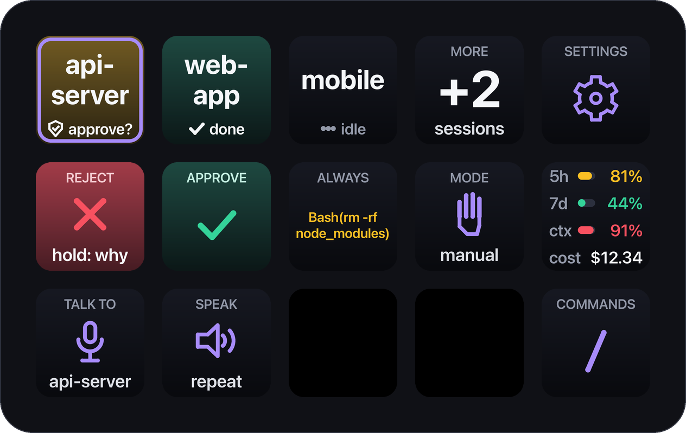
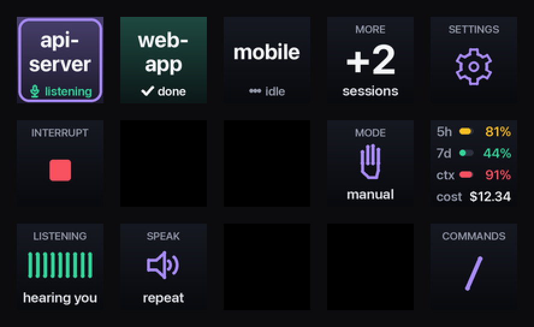
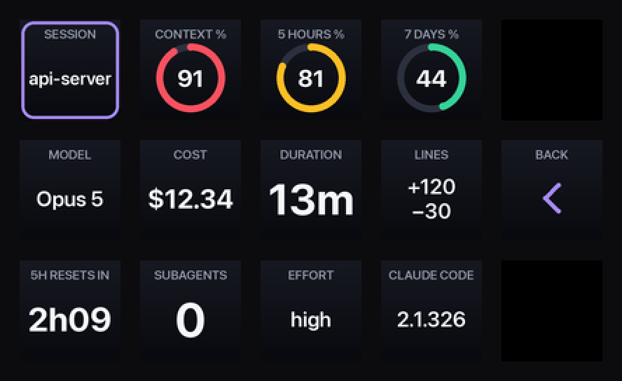

# Decktate

A Stream Deck control surface for [Claude Code](https://code.claude.com) on
macOS. It shows what your sessions are doing, tells you out loud when one
needs you, and lets you answer with a key: approve, reject, pick an option,
or just talk.

<p align="center">
  
</p>

- **See** every Claude Code session on your Mac: working, done, waiting for you.
- **Hear** what a session asks for or finished with.
- **Answer** permission requests and questions with a key press.
- **Talk** to a session: hold a key and speak, or tap it and talk hands-free.

No Elgato software is needed; the deck is driven directly over USB.

## What you need

- a Mac
- a 15-key Stream Deck (Original or MK.2)
- [Claude Code](https://code.claude.com)
- [Homebrew](https://brew.sh)
- optional, for speech: a [Deepgram](https://deepgram.com) key (dictation) and an
  [ElevenLabs](https://elevenlabs.io) key (a natural voice; without it the Mac's own voice is used)

## Install

1. Quit the Elgato Stream Deck app if it is running. Only one program can use the deck.

2. Install the tools and Decktate:

       brew install uv hidapi
       git clone https://github.com/agranig/decktate.git
       cd decktate
       uv sync

3. Check that everything is found (deck, Claude Code, audio, keys):

       uv run decktate doctor

4. Create the app and open it:

       uv run decktate install-app
       open ~/Applications/Decktate.app

A small key-grid icon appears in the menu bar at the top right, and the deck
lights up. That is all: Claude Code sessions you have open show up on the
keys.

To start Decktate at login, add `Decktate` under System Settings > General >
Login Items.

### Speech (optional)

Put your keys into the file `~/.config/decktate/.env`:

    DEEPGRAM_API_KEY=...       # dictation
    ELEVENLABS_API_KEY=...     # voice

Then quit and reopen Decktate. Without the Deepgram key there is no talk key;
without the ElevenLabs key the Mac's own voice speaks. An ElevenLabs key
needs access to *Text to Speech* and to read *Voices*.

### Permissions macOS asks for

The first time, macOS asks whether "Decktate" may use the **microphone**
(dictation) and may **control your terminal** (to type what you dictate).
Allow both. Terminals other than iTerm2 also need Decktate under System
Settings > Privacy & Security > Accessibility.

## The home screen

```
[ session ] [ session       ] [ session ] [ +N more ] [ settings ]
[ reject  ] [ approve       ] [ always  ] [ mode    ] [ stats    ]
[ talk    ] [ speak         ] [ discard ] [ running ] [ commands ]
```

A key that has nothing to do right now stays dark.

### Sessions

- Each session has a key with its **name** and its **state**: idle, working
  (with the tool it runs), done, "approve?", question.
- **Tap** a session to talk to it. It gets the coloured outline, and Decktate
  tells you what it needs or what it finished.
- A key **blinks** when its session wants you. Nothing switches by itself: you
  stay with the session you chose until you tap another one.
- **+N more** lists the sessions that are not on the three keys.
- **Hold** a session key for its menu: *detach* (the deck ignores this
  session from now on) and *quit* (closes the Claude Code session; hold the
  key for two seconds).
- Two sessions in folders of the same name are numbered ("deck 1",
  "deck 2"). Use `/rename` in Claude Code to give a session a proper name.

### Answering

- **Permission request:** the session's key turns amber and the request is
  read out. Tap the session, then **approve** or **reject**. Hold *reject* and
  speak to tell Claude why.
- **Always:** shows the exact rule ("Bash(npm test)"). Hold it until the
  outline has run around the key; the rule then applies for the rest of that
  session.
- **Questions:** when Claude asks you to choose, the options appear on the
  keys. Tap one; for multiple choice tap several and then *confirm*.
- If you do nothing for two minutes, the question appears in the terminal as
  usual.

### Talking

- The **talk** key names the session it talks to and is green when it is
  your turn.
- **Hold** it and speak; let go to send.
- Or **tap** it, talk hands-free, and tap again to send. *Discard* drops what
  you said.
- While it listens, the key shows bars that move with your voice.

<p align="center"></p>
- While Claude is busy, what you send waits in its queue. **Send now** (next
  to the red *interrupt* key) delivers it immediately.

### Listening

- When a session finishes, its whole answer is read out (code blocks are
  skipped).
- **Speak** repeats the last message. While the voice is talking, the key
  turns into **quiet**.
- Turn the Mac's volume down to zero and nothing is spoken; the key then
  shows a crossed-out speaker.

### Mode, stats, commands

- **Mode** shows the permission mode of the session (manual, edits, plan,
  auto) and switches to the next one, like Shift+Tab.
- **Stats** shows the 5-hour and 7-day quota, context and cost at a glance.
  Tap it for the details.
- **Running** (bottom row) appears while the session has something going
  on in the background: the number of shells, monitors and subagents. Tap it
  to hear it.
- **Commands** opens your slash commands (`/compact`, `/clear`, ...).
  **/btw** is special: hold it and ask a question out loud. Claude answers
  on the side while it keeps working on its task, and the answer is read
  out (in iTerm2 and Terminal.app).

### Settings

The gear key opens one key per topic. Each shows what is set; tap it to
change it.

| Topic | What you can set |
| --- | --- |
| Sound | speaker, volume, test |
| Microphone | microphone, language (English, German, mixed), test |
| Voice | voice, talk speed, whether requests and answers are read out |
| Display | brightness |

<p align="center"></p>

## The menu bar icon

The icon in the menu bar shows a number when sessions need you. Its menu
lists the sessions (click one to talk to it) and has *Quit Decktate*. If you
cannot see the icon, your menu bar is full: hold Cmd and drag other icons
out of the way.

## Good to know

- **Claude Code stays as it is.** Decktate adds its hooks to Claude Code's
  settings while it runs and removes them when it quits.
- **Nothing is decided without you.** A request is only answered by a key
  you press. If Decktate is not running or the deck is unplugged, Claude Code
  asks in the terminal as always.
- **Speech goes to the cloud** when you use Deepgram or ElevenLabs. Code
  blocks are left out and keys, tokens and passwords are removed before
  anything is spoken. `mute_projects` in the config keeps whole projects
  silent.
- **Terminals.** iTerm2 works best: Decktate types into it in the
  background. In Terminal.app the mode, interrupt and send-now keys bring
  the window to the front; in other terminals all typing does. A mode you
  switch in the terminal itself shows on the deck at once in iTerm2 and
  Terminal.app, elsewhere with the session's next action.
- **More settings** (slash commands, port, muted projects, ...) are in
  `~/.config/decktate/config.yaml`; see [config.example.yaml](config.example.yaml).

## Problems

| Problem | What to do |
| --- | --- |
| The deck stays dark | Quit the Elgato app, then reopen Decktate. Run `uv run decktate doctor`. |
| "Port is already in use" | Another program uses port 47873. Set a different `port:` in `config.yaml`. |
| No talk key | The Deepgram key is missing or wrong; `uv run decktate doctor` says which. |
| Nothing is typed into the terminal | Allow Decktate to control your terminal (System Settings > Privacy & Security > Automation, and Accessibility for terminals other than iTerm2). |
| A session is missing | It may be detached: open *+N more* and tap it. |

## Uninstall

Quit Decktate (its hooks are removed on quit), then delete
`~/Applications/Decktate.app`, the `decktate` folder and `~/.config/decktate`.

## How it works

Hooks, the terminal integration, the files Decktate keeps, safety details and
development notes are in [docs/ARCHITECTURE.md](docs/ARCHITECTURE.md).

## License

MIT. Copyright (c) 2026 Andreas Granig.
