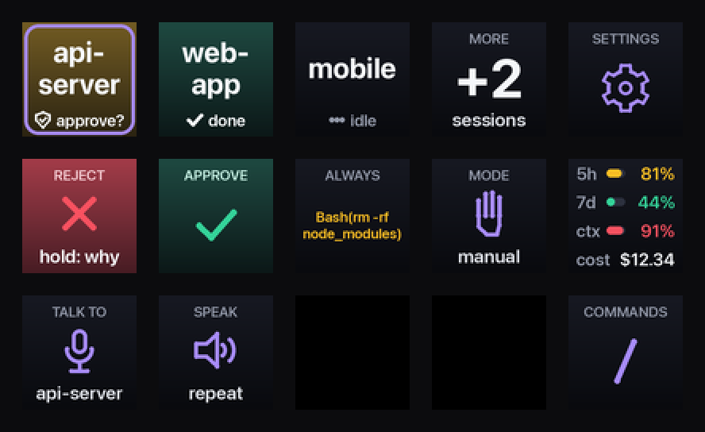

# Decktate

A Stream Deck control surface for [Claude Code](https://code.claude.com). It shows
what your sessions are doing, tells you out loud when one needs you, and lets
you answer with a key: approve, reject, pick an option, or hold a key and
dictate.



No Elgato software. The deck is driven directly over USB.

## What it does

- **Session keys.** One key per session: the name in large letters, and
  below it a pictogram and a word for the state. It blinks when Claude is
  waiting for you. Tap it to select the session and hear what it needs or
  what it finished; the selected session has the coloured outline. Sessions
  in folders of the same name are numbered ("deck 1", "deck 2"); a session
  renamed in Claude Code (`/rename`) shows that name.
- **Approve, reject, always allow.** A permission request lights the three
  keys and is read out. *Always* shows the exact rule and needs a confirm
  hold; it applies to the current session only. Hold *Reject* to dictate a
  reason that Claude receives.
- **Menus on keys.** When Claude asks a question, the options appear on the
  keys, including multi-select.
- **Dictation.** The mic key names the session it talks to, and is green
  when it is your turn (Claude is not in the middle of something). Hold it and
  speak, or tap it to talk hands-free and tap it again to send (the cross,
  always two keys to the right of the mic key, discards; a take nobody ends is dropped after five minutes). While you
  speak it shows level bars that move with your voice ("hearing you", or
  "no sound" if the microphone delivers nothing), and the session's own key
  says "listening" too. When you release the key (or tap to send), the text
  is sent to the session that was selected when you pressed the key. Recording
  starts the moment the key goes down and runs a moment past the release, so
  the first and the last word are not lost.
- **Commands, stop, send now, mode.** Slash commands, interrupt, *send now*
  (Ctrl+Enter: text you dictated or sent from the deck while Claude is
  busy waits in its queue; the key appears only then and sends it at once) and the permission mode of the selected session
  (tap for the next one, as Shift+Tab does).
- **Stats.** Context use, 5-hour and 7-day limits, cost, model, lines changed.
- **Spoken summaries.** When a session finishes, the first sentences of its
  answer are read out. While it talks, the speak key turns into a "quiet"
  key that stops it; the other keys leave it talking, so you can use the
  deck meanwhile (starting a dictation stops it too).

```
[ S1  ] [ S2      ] [ S3            ] [ +N more  ] [ SETTINGS ]
[ NO/INT  ] [ OK / SEND NOW ] [ ALWAYS  ] [ MODE     ] [ STATS    ]
[ MIC     ] [ SPEAK         ] [ discard ] [ result   ] [  /       ]
```

A key that has nothing to do at the moment is blank: approve, reject and
always only appear while a request is pending, stop only while the selected
session is busy (it shares the reject key), send now only while text from
the deck is queued, speak
once there is something to repeat. With the computer's volume at zero the
speak key shows a crossed-out speaker ("muted") and nothing is spoken.

- **Mode and queue from the terminal.** Claude Code fires no hook when the
  mode is switched in the terminal, or when a typed message waits in its
  queue. In iTerm2 and Terminal.app Decktate therefore reads the bottom of
  the session's screen (Claude Code's own mode line, not your status line):
  the selected session about once a second and at once when you select it,
  the others every few seconds. In other terminals the mode follows with
  the session's next hook.
- **Stats after a restart.** Context, cost and quota are kept in
  `stats.json` and shown again right away; the 5-hour and 7-day quota are
  the account's, so what one session reports is shown for all.
- **Every running session is attached** unless you detached it; it does
  not have to report first. Which session is on which key, and which one
  you talk to, is kept in `layout.json`: after a restart of Decktate the
  keys come back exactly as they were.
- **More sessions.** The "+N" key counts the Claude Code sessions running
  on this computer that are not on the three keys, and opens the list of
  them: attached ones with their state, the ones that are not attached grey
  ("detached"). Tap a grey one to attach it; tap an attached one to talk to
  it. The key is not shown when every session is on a key.
- **Session menu.** Hold a session key (on the main page or in the list):
  *talk to*, *detach* (the deck leaves the session alone: no key, no voice,
  its permission requests are asked in the terminal again; this is
  remembered in `detached.json` across restarts, until you attach the
  session again) and *quit* (closes
  the Claude Code session itself; needs a confirm hold, and the conversation
  can be resumed later with `claude --resume`).
- **Sessions stay put.** A session keeps its key for as long as it exists,
  whatever it or the others do, and the session you talk to only changes
  when you tap another one: a permission request or a question makes its
  session's key blink (the "+N" key, if it has none), it does not switch
  you over. A key changes only when you select a session that has no key,
  or when a session ends or is detached: then the sessions to its right
  move up, so there is never a gap. `/clear` and `/resume` start a new session in the
  same terminal; it keeps the key and stays selected.
- **Stats key.** Four lines in one size: 5-hour quota, 7-day quota, context
  and cost. The three percentages have a small bar and are green, amber from
  70 %, red from 90 %. Tap for the full stats page.
- **`/` key.** Opens the slash commands (any number, paged).

## Install

Needs a 15-key Stream Deck, [uv](https://docs.astral.sh/uv/), and on macOS
`brew install hidapi` (Linux: `libhidapi-libusb0` and a udev rule for the
deck). Quit the Elgato app; only one program can hold the device.

    git clone <this repo> && cd decktate
    uv sync
    uv run decktate doctor        # checks deck, Claude Code, audio, keys
    uv run decktate               # run it

While it runs, Decktate adds its hooks to `~/.claude/settings.json`, and it
removes them again when it quits, so Claude Code is exactly as before
whenever Decktate is not running. It only touches its own entries and keeps
one copy of the file as it was (`settings.json.decktate-backup`). An existing
status line keeps working: Decktate runs it after taking a copy of the data.

If Decktate is killed without a chance to clean up, the hooks stay behind;
that is harmless and the next start replaces them. To manage them yourself,
set `auto_hooks: false` and use `uv run decktate install` / `uninstall`.

### As a Dock app (macOS)

    uv run decktate install-app   # creates ~/Applications/Decktate.app

Open it and keep it in the Dock. The icon shows a badge with the number of
sessions that need you; its menu lists the sessions and installs or removes
the hooks. Microphone and automation permissions are then asked for
"Decktate" rather than for your terminal.

### Without a deck

    uv run decktate --sim         # the board as a web page: http://127.0.0.1:8766/

## Speech

Speech is optional and works in steps:

| | Without a key | With a key |
|---|---|---|
| Voice | the operating system's voice (`say`, `espeak-ng`) | ElevenLabs (`ELEVENLABS_API_KEY`) |
| Dictation | off | Deepgram (`DEEPGRAM_API_KEY`) |

Put the keys into `~/.config/decktate/.env`. Microphone and speaker are
detected at runtime: `uv run decktate devices` lists them, and they can be
switched on the deck (the settings key) together with voice, language
(English, German, mixed) and brightness. The quieter and louder keys change
the computer's own output volume. Talk speed has its own two
keys there, faster and slower, in steps of 0.05 (default 1.2x); each change
reads out a sample at the new speed.

## How it connects to Claude Code

Claude Code calls [hooks](https://code.claude.com/docs/en/hooks) over HTTP on
`127.0.0.1`. That is all Decktate needs for status, approvals, menus and
spoken prompts, so those work in every terminal:

| Feature | How |
|---|---|
| Session state | hook events (prompt, tool use, notification, stop, ...) |
| Approve / reject / always | the `PermissionRequest` hook is held open until a key is pressed |
| Menus | the hook for the question tool returns the chosen answers |
| Spoken summary | the `Stop` hook carries the last message |
| Stats | the status line data |

Three things have to type into the session, because Claude Code has no other
way to receive them: dictated prompts, slash commands, and the mode and stop
keys. Decktate uses the terminal's own interface for that:

| Terminal | How | Notes |
|---|---|---|
| iTerm2 | scripting interface | works in the background |
| Terminal.app | scripting interface for text, keystrokes for Esc and Shift+Tab | keys need the Accessibility permission and bring the window forward |
| kitty, WezTerm | their remote-control commands | must be enabled in their config |
| tmux | `send-keys` | used automatically when the session runs in tmux; never required |
| other macOS terminals | keystrokes to the app | Accessibility permission; brings the window forward |
| other Linux terminals | `xdotool` | types into the focused window |

## Safety

- **It never decides on its own.** A decision is only sent after a physical
  key press. If the deck is unplugged, Decktate is not running, a request
  times out, or you answer in the terminal first, the hook returns nothing
  and Claude Code shows its normal prompt.
- **Hooks are local.** They listen on loopback only and require a token that
  is created on first run (`~/.config/decktate/token`).
- **Speech leaves the machine** when a cloud voice or dictation is used.
  Text is stripped of code blocks and passed through a redaction step for
  keys, tokens and passwords before it is spoken. `mute_projects` silences
  whole projects, and `tts: system` keeps the voice local.
- **Audit log.** Every decision made from the deck is appended to
  `~/.config/decktate/audit.jsonl`.

One thing to know: while Decktate is running with a deck, a question waits
for the deck first (default 120 seconds, `permission_hold_s`) before the
terminal asks; the terminal shows a "running hook" line meanwhile. Permission
requests are held the same way. The red key in the menu, or unplugging the
deck, hands the request back at once.

## Status

Tested against Claude Code 2.1.326 on macOS with a Stream Deck Original (15
keys): approvals and menus end to end with a real session; the rest against
a simulator. Not built yet: a Linux tray app and a Docker image.

## Development

    uv run pytest                          # simulator only: no deck, network or microphone
    uv run python tests/shots.py           # re-render docs/screens

## License

MIT. Copyright (c) 2026 Andreas Granig.
